<!--
  GENERATED by scripts/gen_profile.py. Do not edit by hand.
  Edit profile.config.json, then:
      python3 scripts/fetch_profile_data.py && python3 scripts/gen_profile.py
  The Refresh profile Action does this daily.
-->

 

<table width="100%" border="0" cellspacing="0" cellpadding="0">
<tr>
<td width="50%" valign="top" style="padding-right:8px;padding-bottom:8px;"></td>
<td width="50%" valign="top" style="padding-left:8px;padding-bottom:8px;"></td>
</tr>
<tr>
<td width="50%" valign="top" style="padding-right:8px;padding-bottom:8px;"></td>
<td width="50%" valign="top" style="padding-left:8px;padding-bottom:8px;"></td>
</tr>
</table>

 
 
 
 

&nbsp;&nbsp;&nbsp;&nbsp;&nbsp;&nbsp;

