<!--
  GENERATED by scripts/gen_profile.py. Do not edit by hand.
  Edit profile.config.json, then:
      python3 scripts/fetch_profile_data.py && python3 scripts/gen_profile.py
  Art direction: direcao.md (AS-BUILT).
-->

 

 
<a href="https://kevinm.tech"></a> 
 
 
 

 
<a href="https://kevinm.tech/blog/gitops-with-argocd/"></a> 
<a href="https://kevinm.tech/blog/k3s-on-gcp/"></a> 
<a href="https://kevinm.tech/blog/finops-cloud-cost/"></a> 

 
<a href="https://kevinm.tech"></a><a href="https://www.linkedin.com/in/kevinmds"></a><a href="https://kevinm.tech/blog/"></a>

